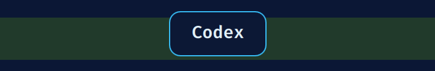

# Dynamic App Switch Overlay for Omarchy

See the apps on each desktop when you switch to it, even behind fullscreen windows. Now with
themes, sounds, and a settings panel.



Dynamic App Switch Overlay (formerly App Switch Overlay) briefly lists the apps
on your current workspace on the focused monitor, then gets out of the way. It
includes windows hidden behind a fullscreen app and works with your existing
navigation and shortcuts.

- Puts the focused app first and marks it with an accent-colored dot.
- Groups multiple windows of the same app, with a count such as `Kitty ×2`.
- Retriggers on every desktop switch, even when you switch quickly.
- Appears above fullscreen windows without reserving screen space.
- Lets mouse clicks pass through and never takes keyboard focus.
- Shows on workspace changes, even when the newly focused app has the same name.
- Stays quiet on title changes and focus changes between windows on the same desktop.
- Recognizes Factory and Microsoft Teams browser windows by title suffix.

## Themes

Pick a theme in the settings panel. Each theme brings its own animation, sounds,
and options.

- **Base**: the original card in your Omarchy colors. It slides in with a soft
  swoosh and nudges on repeat switches. Options: border color, corner radius.
- **Hulk Smash**: a green fist slams the card down, the screen shakes and cracks
  appear. When it leaves, a second green fist punches up through the card and
  it shatters into flying pieces. Options: shake intensity, number of shards,
  slam fist, cracks building up on repeat switches, and the punch-through fist.

Want more? [Make your own theme](#make-your-own-theme). It's one QML file and a
small JSON file.

## Sounds

Sounds ship inside the plugin in `sounds/` and play from there. Turn them on or
off and set the volume in the settings panel. All sounds were made for this
plugin. The Hulk Smash sounds are generated by `tools/make-hulk-sounds.py`.

## Settings

Open the settings panel:

```bash
omarchy-shell app-switch-overlay settings
```

Run it again (or press Esc, or click ×) to close it. The plugin doesn't add a
keybinding or edit your Hyprland config. To get one, add a line yourself, for
example in `~/.config/hypr/bindings.lua`:

```lua
o.bind("SUPER + SHIFT + K", "App switch overlay settings", "omarchy-shell app-switch-overlay settings")
```

Pick a key combination that's free on your desktop.

The panel has two parts:

- **Global options**: theme, sound on/off, volume, animation speed, how long
  the overlay stays, and position (top or center).
- **Theme options**: built from the selected theme's settings list, so it
  changes when you switch themes.

Changes apply right away and are saved to
`~/.config/djk/app-switch-overlay.json`. You can also edit that file by hand;
the plugin watches it. If the file doesn't exist, sensible defaults are used
(Base theme, sound on at 30% volume, top position). Theme options are stored per
theme:

```json
{
  "theme": "hulk-smash",
  "soundEnabled": true,
  "volume": 0.3,
  "showDuration": 1050,
  "animationSpeed": 1,
  "position": "top",
  "themes": {
    "hulk-smash": { "shakeIntensity": 1, "shardCount": 12, "punchThrough": true }
  }
}
```

Missing or invalid values fall back to the theme's defaults.

## Make your own theme

You can add your own themes, and we'd love to see them. The easiest way: **ask
your AI coding agent to read [AGENTS.md](AGENTS.md) and build a theme for you.**
It has the full contract, rules, a skeleton, and a checklist.

Doing it by hand:

1. **Two files per theme** in `themes/`: `MyTheme.json` (what the theme is and
   which options it has) and `MyTheme.qml` (how it looks). The plugin finds
   themes by scanning `themes/*.json`, so files without a JSON next to them
   (like `HulkFist.qml`) are just helper parts. New themes show up in the
   panel's theme picker automatically; pick yours there or set `"theme"` in
   the settings file to its `id`.

2. **The JSON descriptor** lists the theme's options. The panel builds controls
   from it and the plugin fills in defaults:

   ```json
   {
     "id": "my-theme",
     "name": "My Theme",
     "description": "One sentence shown under the theme picker.",
     "settings": [
       { "key": "glow", "label": "Glow", "type": "bool", "default": true },
       { "key": "size", "label": "Size", "type": "number", "default": 1,
         "min": 0.5, "max": 2, "step": 0.1, "decimals": 1, "suffix": "×" },
       { "key": "style", "label": "Style", "type": "choice", "default": "soft",
         "choices": [ { "label": "Soft", "value": "soft" }, { "label": "Hard", "value": "hard" } ] },
       { "key": "tint", "label": "Tint", "type": "color", "default": "" }
     ]
   }
   ```

   Types are `bool`, `number` (or `slider`), `choice` (or `enum`) and `color`
   (`#rrggbb`, `#aarrggbb`, or `""` for "use the default").

3. **The QML component** receives these from the plugin:

   - `host`: the service. Read `host.apps` (list of `{name, count, focused}`),
     `host.appName`, `host.workspaceName` and `host.settings` (global options).
   - `options`: your resolved options from the JSON, always complete and valid.
   - `primary`: true on the monitor that should show the overlay.

   And it must provide:

   - `active` (bool): true while anything is visible, so the layer stays up.
   - `show()`: the first appearance.
   - `pulse()`: a repeat switch while already showing. Restart quickly.
   - `hide()`: animate out, then let `active` go false.

4. **Sounds**: put `.wav` files in `sounds/` and play them with the bundled
   `Sfx` component:

   ```qml
   Sfx { id: whoosh; sound: "my-whoosh.wav"; volume: Number(theme.s.volume)
         enabled: theme.s.soundEnabled !== false }
   // in show(): if (primary) whoosh.play();
   ```

A minimal theme:

```qml
import QtQuick
import qs.Commons as Commons
import ".."

Item {
    id: theme
    anchors.fill: parent
    property var host: null
    property var options: ({})
    property bool primary: false
    readonly property var s: host ? host.settings : ({})
    property bool shown: false
    readonly property bool active: shown || card.opacity > 0

    function show() { shown = true; }
    function pulse() { bump.restart(); }
    function hide() { shown = false; }

    Rectangle {
        id: card
        anchors.horizontalCenter: parent.horizontalCenter
        y: theme.s.position === "center" ? (theme.height - height) / 2 : 52
        width: label.implicitWidth + 48; height: 56; radius: 12
        color: Commons.Color.background
        border.color: theme.options.tint ? theme.options.tint : Commons.Color.accent
        opacity: theme.shown ? 1 : 0
        Behavior on opacity { NumberAnimation { duration: 160 } }
        Text { id: label; anchors.centerIn: parent; color: Commons.Color.foreground
               text: theme.host ? theme.host.appName : ""; font.pixelSize: 18 }
        SequentialAnimation on scale { id: bump; running: false
            NumberAnimation { to: 1.05; duration: 60 } NumberAnimation { to: 1; duration: 90 } }
    }
}
```

For complete examples see [themes/Base.qml](themes/Base.qml) (simple) and
[themes/HulkSmash.qml](themes/HulkSmash.qml) (layered effects, several sounds,
rapid retriggers). Built something fun? Share it in an issue or pull request.

## Requirements

Omarchy Quattro with `omarchy-shell` and Hyprland. Qt Quick, Qt Multimedia,
Qt Labs FolderListModel, Quickshell's Wayland and Hyprland modules, and the
Omarchy theme modules are supplied by the desktop. If Qt Multimedia isn't
available, sounds fall back to PipeWire's `pw-play`. Older Waybar-based
Omarchy versions and standalone Hyprland installations are not supported.

## Install

```bash
omarchy plugin add https://github.com/yourguide/omarchy-app-switch-overlay.git --enable
```

## Install from a downloaded copy

From the directory containing this README:

```bash
plugin_dir="$HOME/.config/omarchy/plugins/djk.app-switch-overlay"
if [ -e "$plugin_dir" ]; then
  echo "Already installed; follow the update instructions below."
else
  mkdir -p "$plugin_dir"
  cp -r manifest.json AppNames.js Service.qml SettingsPanel.qml Sfx.qml SoundBank.qml \
    themes sounds "$plugin_dir/"
  omarchy plugin validate "$plugin_dir"
  omarchy-shell shell rescanPlugins
fi
```

Once discovery completes, enable it:

```bash
omarchy plugin enable djk.app-switch-overlay
```

No desktop restart required.

## Preview, disable, and remove

```bash
omarchy-shell app-switch-overlay preview
omarchy-shell app-switch-overlay status
omarchy plugin disable djk.app-switch-overlay
omarchy plugin remove djk.app-switch-overlay
```

Removal deletes the plugin's files and enabled-state entry. Your settings file
stays; delete `~/.config/djk/app-switch-overlay.json` if you don't want it. If
you added a keybinding for the settings panel, remove that line yourself.

## Update

Git installs: `omarchy plugin update djk.app-switch-overlay`.
Manual installs: disable, back up the installed directory, copy the runtime
files and the `themes` and `sounds` directories over it, then enable again.

**Upgrading to 2.1.0**: the plugin ID, IPC name (`app-switch-overlay`) and
settings file stay the same. Settings from 2.0.0's `hulk` block move to
`themes["hulk-smash"]` automatically the first time 2.1.0 loads, so your Hulk
Smash options carry over. If the shell still shows the old overlay after
updating, run `omarchy restart shell` to clear cached QML; application
windows stay open.

## Customize app names

`AppNames.js` holds friendly names and browser title rules. Unrecognized apps use
their desktop entry name, or their app ID. Other web apps may need a mapping.

## Privacy and verification

Reads workspace windows' app IDs and titles in memory to choose labels and shows
app names rather than document or conversation titles. Stores no titles, makes
no network calls, and sends no telemetry. The only file it writes is its
settings file. Sounds play through Qt Multimedia; only if that is unavailable
does it start a short `pw-play` process per sound. The overlay never takes
keyboard focus; the settings panel accepts keyboard input only while you have
it open. Omarchy plugins run inside the shell without sandboxing.

2.1.0 was checked on the author's desktop: both themes preview and retrigger,
the settings panel shows each theme's own options and switches them with the
theme, 2.0.0 Hulk settings migrated with their values intact, sounds played
from the plugin's `sounds/` directory, and the shell logged no QML errors.
Multi-monitor routing is implemented but hasn't been tested on multiple
monitors. Browser naming rules are best effort. The preview image shows the
1.x Base card.

2.1.1 was verified with Grok Bot and Chrome tiled side by side: changing window
focus did not trigger the overlay, and switching desktops did. Restart the shell
after upgrading (`omarchy restart shell`) to ensure the updated QML is loaded.

## Development checks

```bash
node tests/workspace-apps.test.cjs
node tests/workspace-triggers.test.cjs
node tests/theme-schemas.test.cjs
omarchy plugin validate .
```

## License

MIT. See [LICENSE](LICENSE).
